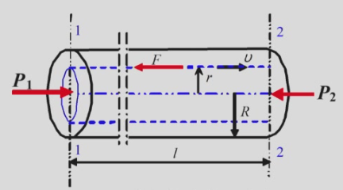
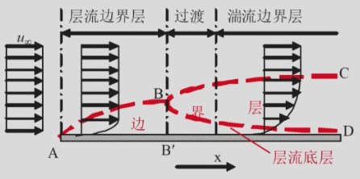
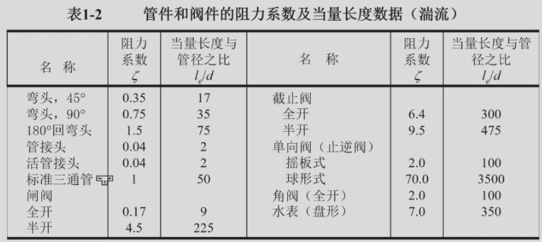
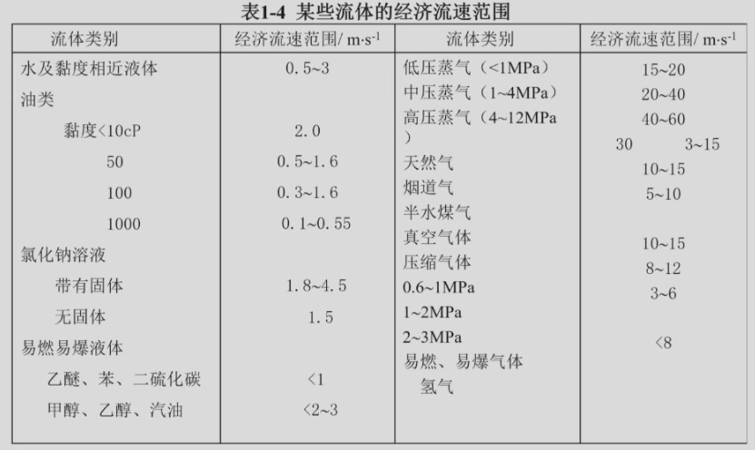
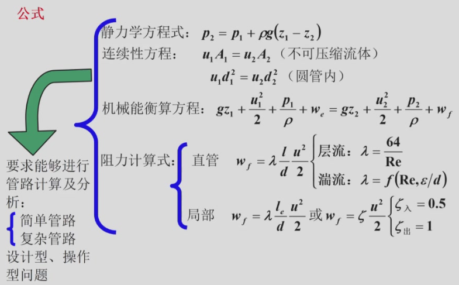
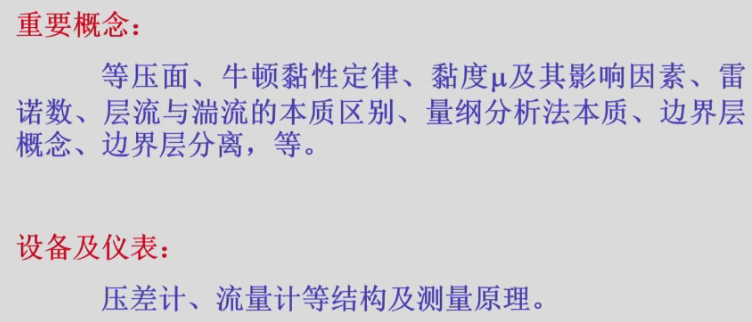

# 第一章 流体流动

## 流体静止的基本方程

### 几个概念

#### 密度

$\rho$，属于物理性质，单位：kg/m$^3$

获得方法：

(1) 查阅物性数据手册

(2) 公式计算：

液体：（要求混合前后总体积近似不变）

$$
\frac{1}{\rho_m} = \frac{a_1}{\rho_1} + \frac{a_2}{\rho_2} + \dots + \frac{a_n}{\rho_n}
$$

气体：

$$
\rho_m = \varphi_1 \rho_1 + \varphi_2 \rho_2 + \dots + \varphi_n \rho_n
$$

#### 静压力（压强）

$p$，属于物理性质，具有各向同性。

国际单位制中单位为：N/m$^2$ = Pa

$$
1 \ \text{atm} = 1.013 \times 10^5 \ \text{Pa} = 760 \ mm \ \text{Hg} = 10.33 \ m \ \text{H}_2\text{O}
$$

压力大小的表征方法：绝压（绝对压力，以绝对真空为基准）、表压（以当地大气压为基准）、真空度（表示负压体系低于当地大气压的压力数值，注意是非负的绝对值）

#### 压缩性

流体分为可压缩流体和不可压缩流体，通常认为液体是不可压缩流体，气体是可压缩流体。但当压力、温度变化均不大时可认为气体也是不可压缩流体。

### 流体静力学方程

#### 推导

在某截面积为 $A$ 的竖直流体中取一段微元 $dz$，它受到上表面向下的压力 $(p+dp)A$，下表面压力 $pA$，重力 $\rho g A dz$，受力平衡有：

$$
pA-(p+dp)A-\rho gAdz = 0
$$

简化为：

$$
dp + \rho g dz = 0
$$

积分得：

$$
p + \rho g z = 常数
$$

因此：

$$
p_2 = p_1 + \rho g(z_1-z_2) \tag{1.1}
$$

即：

$$
\frac{p_2}{\rho g} = \frac{p_1}{\rho g} + (z_1-z_2) \tag{1.2}
$$

工程上，我们称 $\frac{p}{\rho g}$ 为静压头，$z$ 为位头，称方程 (1.1) (1.2) 为流体静力学方程。

#### 讨论

适用范围：重力场中静止、连续、均质、不可压缩的流体。

等高面（水平面）就是等压面，高度越低压力越大。任意平面压力的变化必然引起流体内部各点发生同样大小的变化，即压力的可传递性。（即帕斯卡原理）

**在水平截面上也满足流体静力学方程。**

#### 应用

- 压力测量：

(1) 单管压力计：

取单管内液体密度 $\rho$，液柱高度 $R$，大气压 $p_0$。

$$
p_1 = p_0 + \rho g R
$$

显然，不适用于与大气压相差过大的体系（防止液柱过高），同时不适用于负压体系或气体环境（防止液体流入/气体逸出）。

(2) U 形管压力计：

引入指示剂，取密度为 $\rho_0$，

$$
p_1 + \rho g h = p_0 + \rho_0 g R
$$

可以测液体、气体；可以测负压（也不应差距太大）

- 压差测量：

(1) U 形管压差计：

$$
p_1 + \rho g (z_1 + R) = p_2 + \rho g z_2 + \rho_0 g R
$$

(2) 双液体压差计：

在 U 形管两侧增设两个小室，两种指示液互不相溶、密度差异小。认为小室液面不动。

$$
p_1 + \rho_1 g (z_1 + R) = p_2 + \rho_1 g z_1 + \rho_2 g R
$$

化简得：

$$
p_1 - p_2 = (\rho_2 - \rho_1) g R
$$

通过减小 $(\rho_2-\rho_1)$，可以放大 U 形管的读数，减小误差。

## 流体流动的基本方程

主要研究流体在管路中的流动，遵循三大守恒定律。（本课程不涉及动量守恒）

### 基本概念

#### 稳定流动和不稳定流动

稳定流动要求固定位置上的流动参数（流速、压力、密度等）都不随时间变化，只要有一个参数随时间变化就算不稳定流动（如开工或停工阶段）。

#### 流量和流速

流量分为质量流量（$m_s$，单位 kg/s）和体积流量（$V_s$，单位 m$^3$/s），显然 $m_s = \rho V_s$

流速分为质量流速（$G = m_s/A$）、体积流速（$u = V_s/A = \frac{\iint_A{vdA}}{A}$）和点速度（$v$，单位 m/s），同样有 $G=\rho u$，$m = \rho u A$

#### 黏性与黏度

流体内部存在内摩擦力或黏滞力，气体内摩擦力产生的原因可以从动量传递角度理解，液体的内摩擦力则是由分子间吸引力产生。

剪应力 $\tau$ 表示单位面积上的内摩擦力，单位为 N/m$^2$，公式如下：

$$
\tau = \mu \frac{dv_x}{dy} \tag{1.3}
$$

微分式 $\frac{dv_x}{dy}$ 为速度梯度；方程 (1.3) 称为牛顿黏性定律。

$\mu$ 表示动力黏度，简称黏度，是衡量流体黏性大小的一个物理量，其单位可以通过力与速度梯度的比值获得：

$$
[\mu] = \frac{N/m^2}{(m/s)/m} = Pa \cdot s
$$

常用单位还有泊（$P$），换算为：$1 Pa \cdot s = 10 P = 1000 cP$

黏度是物理性质，获得方式可以由实验测定、手册查阅、经验公式计算。

影响黏度的因素主要有体系、温度、浓度，其中温度升高，液体黏度降低，气体黏度升高。

#### 牛顿型和非牛顿型流体

符合牛顿黏性定律的流体称为牛顿流体（所有气体和大部分低分子量液体或溶液）；非牛顿流体不符合牛顿黏性定律（绝大部分高分子量的流体，如人体血液、淋巴液等多种体液，聚乙烯、聚丙烯酰胺、聚氯乙烯、尼龙66、涤纶、橡胶溶液、各种工程塑料、化纤熔体等）。

### 质量衡算——连续性方程

质量守恒定律——封闭体系中物质质量不变

质量衡算方程——开放体系中，质量守恒定律改为：

（输出控制体的质量流量）-（输入控制体的质量流量）+（控制体内质量随时间的变化率）= 0

对于稳定流动，第三项为 0，所以我们得到输入输出相等。

$$
\rho_1 u_1 A_1 = \rho_2 u_2 A_2
$$

若 $\rho_1 = \rho_2 = const.$，有：

$$
u_1 A_1 = u_2 A_2
$$

即：

$$
u_1 d_1^2 = u_2 d_2^2
$$

对于带分支的管道，取控制体的时候需要包括所有分支，有：

$$
uA = u_1 A_1 + u_2 A_2 + \dots + u_n A_n
$$

### 机械能衡算方程

对于稳定流动的流动系统，（输入的能量速率）=（输出的能量速率），取控制体需要包括所有的进出口（如泵、换热器等等）

#### 流体的能量形式

运动着的流体涉及的能量形式有：内能、动能、位能、压力能、外功、热

- 内能（$U$，J/kg），取决于温度（分子动能、分子间相互作用势能、分子热运动的统计平均动能）；

- 动能（$u^2/2$，J/kg），流体运动的能量；

- 位能（$gz$，J/kg），即势能；

- 压力能（$p/\rho$，J/kg），将流体压入流动系统需要抵抗压力做功；

- 外功（$w_e$），如泵（正功）、水力传动装置（负功）；

- 热（$q_e$），传热，有冷却器、加热器等等，吸热为正。

机械能不考虑内能和热。

> 对压力能，将 1kg 的流体压过某界面，所作功为：$P_1 z_1= (p_1 A_1)(v_1/A_1) = p_1 v_1 = p_1/\rho_1$

#### 理想流体的伯努利方程

理想流体的黏度 $\mu$ = 0

对始末截面 1 和 2，有守恒方程：

$$
gz_1 + \frac{u_1^2}{2} + \frac{p_1}{\rho_1} + w_e = gz_2 + \frac{u_2^2}{2} + \frac{p_2}{\rho_2}
$$

若不考虑外功，$\rho_1 = \rho_2 = \rho$，则化简得：

$$
gz_1 + \frac{u_1^2}{2} + \frac{p_1}{\rho} = gz_2 + \frac{u_2^2}{2} + \frac{p_2}{\rho} \tag{1.4}
$$

方程 (1.4) 是不可压缩理想流体作稳定流动时的机械能衡算方程，称为伯努利方程。

对于没有黏性的流体，流动系统上游的机械能等于下游的机械能。

#### 实际流体的机械能衡算

考虑外功和过程损失，

$$
gz_1 + \frac{u_1^2}{2} + \frac{p_1}{\rho} + w_e = gz_2 + \frac{u_2^2}{2} + \frac{p_2}{\rho} + w_f \tag{1.5}
$$

或改写成：

$$
z_1 + \frac{u_1^2}{2g} + \frac{p_1}{\rho g} + h_e = z_2 + \frac{u_2^2}{2g} + \frac{p_2}{\rho g} + h_f \tag{1.5a}
$$

$$
\rho gz_1 + \frac{\rho u_1^2}{2} + p_1 + \Delta p_e = \rho gz_2 + \frac{\rho u_2^2}{2} + p_2 + \Delta p_f \tag{1.5b}
$$

#### 讨论

适用范围：不可压缩、连续、均质、稳定流动

静止时，$u_1 = u_2 = 0$，可以化简得到流体静力学方程。

若流动系统无外加功，即 $w_e = 0$，则：

$$
Et_1 = Et_2 + w_f
$$

$Et$ 指的是流体自身具有的机械能，由于 $w_f > 0$，所以 $Et_1 > Et_2$，即流体自发从高（机械能）能位流向低（机械能）能位。

**因此涉及流体流向的问题就是求 $Et_1$ 与 $Et_2$ 的大小关系。**

> 使用机械能衡算方程时，应注意以下几点：
> 
> 控制体与控制面的选取：包含待求变量，控制体内流体连续且均质，控制面与流动方向垂直，已知条件尽可能多。
> 
> 基准水平面的选取：一般将基准面定在某一流通截面的中心上。
> 
> 压力：用绝压或表压均可，但两边必须统一，一般用表压更方便，此时与大气接触位置 $p = 0$。

## 流体流动现象

### 流动型态

雷诺实验：用着色水指示管道内水的流动状态，发现当流速较低时，水流呈细线状，质点作直线运动（层流状态）；当流速较高时，水流呈分散状，质点作无规则紊乱运动（湍流状态）。

雷诺数：

$$
Re = \frac{d u \rho}{\mu} = \frac{\rho u^2}{\mu u/d} = \frac{\text{惯性力}}{\text{黏性力}}
$$

惯性力加剧湍动，粘性力抑制湍动。因此根据雷诺数的大小可以判断流动型态：Re $\le$ 2000 为层流，Re $\ge$ 4000 为湍流，2000 < Re < 4000 为过渡区。

$$
[Re] = [\frac{d u \rho}{\mu}] = \frac{m \cdot \frac{m}{s} \cdot \frac{kg}{m^3}}{N \cdot s/m^2} = m^0 kg^0 s^0
$$

可见雷诺数是无量纲数群。

### 湍流的基本概念

在湍流流体中，流体质点的速度大小或方向随时间不断变化，但又围绕某个平均值（时均化）

$$
\overline{v}_x = \frac{1}{t} \int_0^t v_x dt
$$

因此在湍流中任一瞬间的物理量 $A$ 可以表达为时均量 $\overline{A}$ 与脉动量 $A'$ 的和：

$$
A = \overline{A} + A'
$$

### 管内速度分布

{width=50%}

等径管内流动稳定，轴向合力为 0 ，有：

$$
\pi r_1^2 p_1 - \pi r_2^2 p_2 + 2 \pi r l \mu \frac{dv}{dr} = 0
$$

$$
\frac{dv}{dr} = \frac{p_2 - p_1}{2 \mu l} r
$$

考虑初值条件 $v = 0$，$r = R$，有：

$$
\Rightarrow v = \frac{p_2 - p_1}{4 \mu l} (R^2 - r^2)
$$

$$
\Rightarrow v_{max} = \frac{p_2 - p_1}{4 \mu l} R^2, \qquad v = v_{max} (1 - \frac{r^2}{R^2})
$$

$$
\Rightarrow u = \frac{V_s}{A} = \frac{\iint_A v dA}{\pi R^2} = \frac{1}{\pi R^2} \int_0^R v \cdot 2 \pi r dr = \frac{p_2 - p_1}{8 \mu l} R^2 = \frac{\pi R^2}{2} v_{max}
$$

对于湍流，其管内速度分布目前尚不能从理论上导出，只能借助经验公式。

$$
v = v_{max} (1 - \frac{r}{R})^{\frac{1}{n}} \tag{1.6}
$$

式 (1.6) 为一种常用的指数形式的经验式，$n$ 与 Re 大小有关。当 Re 约为 $1.1 \times 10^5$ 时，$n=7$，$u = 0.817 v_{max}$

### 边界层与边界层分离

#### 边界层

在壁面附近，其内部存在速度梯度，一般以速度为主体流速的99%处为划分边界层的界限（$u_x = 0.99 u_{\infty}$）。在离壁面较远处的主体区，速度尚未受到壁面的影响，速度提速几乎为 0 ，可近似视为理想流体。

> 边界层与流动阻力、传热、传质都密切相关。

#### 边界层的形成和发展

{width=30%}

边界层很薄时，边界层内部为层流；随着边界层加厚，边界层内的流动可由层流转变为湍流；其间还有一个过渡区。

在湍流边界层内，由于紧靠壁面处的流体速度仍很小，流动型态保持为层流，称为层流底层。

流动达到充分发展所需的管长称为进口段长度 $L_e$：层流时 $L_e/d = 0.05Re$；湍流时 $L_e = 40 \sim 50 d$。

#### 边界层分离

当流体流过非流线型物体时会发生 **边界层脱离壁面** 的现象，称为边界层分离。

边界层分离虽然在流体输送中应设法避免或减轻，但它对混合及传热、传质又有促进作用，故有时也要加以利用。

## 管内流动的阻力损失

机械能损失 $w_f$ 分为两类：

- 沿程损失（直管损失），来自等径直管

- 局部损失，来自管件或阀门（由于流速大小或方向突然改变，从而产生边界层分离，出现大量漩涡，导致很大的机械能损失）

### 沿程损失的计算通式

机械能衡算公式变形得到：

$$
w_f = \frac{p_1 - p_2}{\rho} + g(z_1 - z_2) = \frac{\Delta p}{\rho} - g h
$$

由受力平衡得：

$$
\pi R^2 \Delta p - \pi R^2 l \rho g \sin \theta - 2 \pi R l \tau_w = 0
$$

$$
\Rightarrow w_f = \frac{\Delta p}{\rho} - g h = \frac{2 \tau_w l}{\rho R} = \frac{4 \tau_w l}{\rho d} = 8 (\frac{\tau_w}{\rho u^2}) (\frac{l}{d}) \frac{u^2}{2}
$$

记 $\lambda = 8 \tau_w / \rho u^2$，

$$
w_f = \lambda \frac{l}{d} \frac{u^2}{2}
$$

#### 层流的摩擦系数

$$
\left\{
\begin{aligned}
v &= v_{max} (1-\frac{r^2}{R^2}) \\
u &= \frac{1}{2} v_{max} \\
\tau_w &= \mu \frac{dv}{dr} \Bigg|_{r=R}
\end{aligned}
\right.
\Rightarrow \tau_w = - \frac{2}{R}\mu v_{max} = - \frac{4}{R}\mu u
$$

$$
\Rightarrow \lambda = \frac{8 \tau_w}{\rho u^2} = \frac{32 \mu}{\rho u R} = \frac{64 \mu}{\rho u d} = \frac{64}{Re}
$$

#### 湍流的摩擦系数

主要依靠实验建立经验关系式，实验在 **量纲分析法** 指导下进行。

以下为量纲分析法的步骤：

(1) 通过实验找到所有影响因素

$$
w_f = f(d, l, i, \rho, \mu, \varepsilon)
$$

(2) 找出各物理量量纲中涉及的基本量纲

$$
[d] = [l] = [\varepsilon] = [m] = L \qquad [u] = [m \cdot s^{-1}] = L \cdot T^{-1}
$$

$$
[\rho] = [kg \cdot m^{-3}] = M \cdot L^{-3} \qquad [\mu] = [Pa \cdot s] = M \cdot L^{-1} \cdot T^{-1}
$$

$$
[w_f] = [J \cdot kg^{-1}] = [(kg \cdot m^2 \cdot s^{-1}) \cdot kg^{-1}] = L^2 \cdot T^{-2}
$$

可见基本量纲个数 $r = 3$

(3) 选择 $r = 3$ 个物理量作为基本物理量

(4) 将其余 $n-r = 7-3 = 4$ 个物理量逐一与基本物理量组成特征数

(5) 根据 **量纲一致性原则** 确定待定指数

最后我们得到：

$$
\frac{w_f}{u^2} = F(Re, \frac{\varepsilon}{d}, \frac{l}{d}) \quad \Rightarrow \quad \lambda = \phi(Re, \varepsilon/d)
$$

$\lambda$, $Re$, $\varepsilon/d$ 三者函数关系的实验结果标绘在双对数坐标图上，称为 **Moody 摩擦系数图** 。

> 由图可见：

> (1) $Re$ $\uparrow$，$\lambda$ $\downarrow$，直至不变；

> (2) $Re$ 从 $10^3 \to 10^8$，$\lambda$ 仅变化小于 10 倍。

> 随着 $Re$ 数的增大，$\varepsilon/d$ 对 $\lambda$ 的影响越来越重要，相反，$Re$ 数对 $\lambda$ 的影响却越来越弱，原因是：

> 对于一定的相对粗糙度 $\varepsilon/d$，$Re$ 越大，则层流底层相对越薄，暴露在湍流主体区的粗糙峰体积增大、数量增多，因而 $\varepsilon/d$ 对 $\lambda$ 的影响也越大；当 $Re$ 增大到一定值后，几乎所有的粗糙峰均暴露在湍流主体区内，此时如再增大 $Re$，对 $\lambda$ 的影响也几乎不变了，此时进入了阻力平方区，该区域的 $\lambda$ - $Re$ 曲线趋近于水平线。

#### 经验公式

对于光滑管，有：

柏拉修斯（Blasius）式：

$$
\lambda = \frac{0.3164}{Re^{0.25}} \qquad (5000 < Re < 10^5)
$$

顾毓珍等公式：

$$
\lambda = 0.0056 + \frac{0.500}{Re^{0.32}} \qquad (3000 < Re < 3\times10^6)
$$

对于粗糙管，有：

科尔布鲁克（Colebrook）式：

$$
\frac{1}{\sqrt{\lambda}} = 1.14 - 2 \log(\frac{\varepsilon}{d} + \frac{9.35}{Re \sqrt{\lambda}}) \qquad (4\times10^3 < Re < 10^8; 5\times10^{-2} < \frac{\varepsilon}{d} < 10^{-6})
$$

$$
\lambda = 0.100(\frac{\varepsilon}{d} + \frac{68}{Re})^{0.23} \qquad (Re \ge 4000; \frac{\varepsilon}{d} \le 0.005)
$$

### 非圆形管的沿程损失

(1) 湍流、形状于圆形相差不大时，

$$
w_f = \lambda \frac{l}{d_e} \frac{u^2}{2} \qquad d_e = \frac{4A}{C_e}
$$

其中，$A$ 为面积，$C_e$ 为周长(包含内外圈)。

(2) 层流时，

$$
\lambda = \frac{C}{Re}
$$

其中，$C$ 为常数，对于正方形、正三角形、环形，$C$ 分别为57、53、96。

### 局部损失

当流体流经弯头、管进出口、阀门等处时，由于流体的 **流速或流动方向** 突然发生变化，产生 **边界层分离** 和涡流，从而导致形体阻力损失。

近似估算方法有两种（结果不完全一致）：

(1) 阻力系数法，$\zeta$ 为局部阻力系数，查表得到

$$
w_f = \zeta \frac{u^2}{2}
$$

(2) 当量长度法，$l_e$ 为当量长度，查表得到

$$
w_f = \lambda \frac{l_e}{d} \frac{u^2}{2}
$$

{width=50%}

- 突然扩大：$\zeta_{out} = 1$，$w_f = \frac{u^2}{2}$

- 突然缩小：$\zeta_{in} = 0.5$，$w_f = 0.5\frac{u^2}{2}$

### 管内流动总阻力损失的计算

$$
w_f = \sum(\lambda \frac{l+l_e}{d}\frac{u^2}{2}) = \sum(\lambda \frac{l}{d} + \zeta)\frac{u^2}{2}
$$

## 管路计算

对不可压缩你流体稳定流动，已有公式：

$$
u_1 A_1 = u_2 A_2
$$

$$
gz_1 + \frac{u_1^2}{2} + \frac{p_1}{\rho} + w_e = gz_2 + \frac{u_2^2}{2} + \frac{p_2}{\rho} + w_f
$$

$$
w_f = \sum(\lambda \frac{l+l_e}{d}\frac{u^2}{2}) = \sum(\lambda \frac{l}{d} + \zeta)\frac{u^2}{2}
$$

### 简单管路

#### 特点

(1) 稳定流动，质量流量不变，对不可压缩流体即体积流量不变，即

$$
V_{s1} = V_{s2} = \dots
$$

(2) 整个管路的总摩擦损失为各管段及各局部摩擦损失之和，即

$$
\sum w_f = w_{f1} + w_{f2} + \dots
$$

按目的不同，计算任务可分为两类：设计型与操作型

#### 设计型任务

指给定输送任务，如流量 $V_s$，要求设计出经济、合理的管路，主要指确定优化的管径 $d$。

$$
d = \sqrt{\frac{V_s}{\pi u/4}}
$$

> 对于给定 $V_s$，$u$ 越小，$d$ 越大，设备费越贵；$u$ 越大，$d$ 越小，设备费便宜，但沿程损失大，操作费贵。因此需要确定能使上述费用之和最小的流速，称为优化流速 $u_{opt}$ 或经济流速。

{width=50%}

由图可见，黏度越大，允许的经济流速越小。

#### 操作型任务

指管路系统已定，要求 **核算** 出在操作条件改变时管路系统的输送能力或某项技术指标。

e.g.:

对一个简单管路，局部阻力系数增加（如阀门关小），管内流量将会减小，阀门上游压力增加，下游压力减小。

### 复杂管路

#### 并联管路的特点

(1) 总流量等于各并联支管流量之和，对于密度不变的流体有：

$$
V_s = V_{s1} + V_{s2} + \dots
$$

(2) 各并联支管的阻力损失相等，即

$$
w_{f1} = w_{f2} = w_{f3}
$$

$$
\lambda_1 \frac{\sum l_1}{d_1} \frac{u_1^2}{2} = \lambda_2 \frac{\sum l_2}{d_2} \frac{u_2^2}{2} = \lambda_3 \frac{\sum l_3}{d_3} \frac{u_3^2}{2}
$$

已知 $u = 4V/\pi d^2$，则：

$$
\frac{8 \lambda_1 \sum l_1}{\pi^2 d_1^5}V_{s1}^2 = \frac{8 \lambda_2 \sum l_2}{\pi^2 d_2^5}V_{s2}^2 = \frac{8 \lambda_3 \sum l_3}{\pi^2 d_3^5}V_{s3}^2
$$

$$
\therefore V_{s1}:V_{s2}:V_{s3} = \sqrt{\frac{d_1^5}{\lambda_1 \sum l_1}}:\sqrt{\frac{d_2^5}{\lambda_2 \sum l_2}}:\sqrt{\frac{d_3^5}{\lambda_3 \sum l_3}}
$$

可见长而细的支管通过的流量小，短而粗的支管通过的流量大。

#### 分支或汇合管路的特点

(1) 总流量等于各并联支管流量之和，对于密度不变的流体有：

$$
V_s = V_{s1} + V_{s2} + \dots
$$

(2) 可在分支点或汇合点处将其分为若干个简单管路，对每一段简单管路仍然满足机械能衡算。

> 较长距离输送时，动能项 $u^2/2$ 相较于阻力损失 $w_f$ 很小，常可忽略不计。

e.g.:

对一个复杂管路，支路中局部阻力系数增加（如阀门关小），该支管内流量将会减小，总流量减小，其余支管流量增加，阀门上游压力增加，下游压力减小。

## 流量测量

本节介绍根据流体力学原理制作的测量流量的仪器。

### 变压头流量计：恒截面，变压头

#### 测速管（Pitot 管）

测量原理：

内管端口（A 点）与流体主体衡算，A 点的静压头等于流体主体的冲压头（静+动）：

$$
\frac{p_A}{\rho g} = \frac{p}{\rho g} + \frac{v^2}{2g}
$$

由静力学原理得：

$$
p_A - p = R(\rho_0 - \rho)g \qquad p_{外管侧孔} = p
$$

$$
\therefore \frac{v^2}{2g} = \frac{R(\rho_0 - \rho)}{\rho} \Rightarrow v = \sqrt{\frac{2gR(\rho_0 - \rho)}{\rho}}
$$

> 测速管尺寸不可过大，一般直径不应超过管径的 1/15。

> 安装时必须保证安装点位于充分发展流段，一般测量点的上、下游最好有 $50d$ 以上的直管段作为稳定段。

> 管口截面要严格垂直于流动方向。

缺点：

- 不能直接测出平均速度；

- 压差计读数小，需放大才能读准

优点：

- 结构简单，阻力小，使用方便，尤其适用于测量气体管道内的流速

#### 孔板流量计

取压方法：

角接取压，取压口紧邻孔板前后端面与管壁的交角处

测量原理：

流体流过孔板有较大压降，流量变化会引起压降变化。通过测出孔板上下游的压差便可计算出流量的大小

不计摩擦，有：

$$
\left.
    \begin{aligned}
    \frac{p_1}{\rho} + \frac{u_1^2}{2} &= \frac{p_0}{\rho} + \frac{u_0^2}{2} \\
    (管道)A_1 u_1 &= A_0 u_0(孔口) \\
    \end{aligned}
\right\} \Rightarrow u_0 = \frac{1}{\sqrt{1-(A_0/A_1)^2}} \sqrt{\frac{2(p_1-p_0)}{\rho}}
$$

考虑流体的阻力损失，

$$
u_0 = \frac{C_D}{\sqrt{1-(A_0/A_1)^2}} \sqrt{\frac{2(p_1-p_0)}{\rho}} = C_0 \sqrt{\frac{2(p_1-p_0)}{\rho}}
$$

称 $C_0$ 为孔流系数。同 6.1.1 节计算压差计得：

$$
\therefore V_s = u_0A_0 = C_0A_0\sqrt{\frac{2gR(\rho_0-\rho)}{\rho}}
$$

> 安装时必须保证安装点位于充分发展流段，一般测量点的上游最好有 $10d_1$ 以上的直管段，下游有 $5d_1$ 作为稳定段。

> 对于测压方式、加工状况等均已确定的标准孔板，常有：$C_0 = f(Re, A_0/A_1)$。

> 实际测量中 $C_0$ 通常认为是常数。

优点：

- 构造简单，制造和安装都很方便

缺点：

- 机械能损失（永久损失）大，$d_0/d_1 = 0.2$ 时，损失约为测得压差的 $96\%$ ，$d_0/d_1 = 0.5$ 时，损失约为 $75\%$

#### 文丘里（Venturi）流量计

收缩段锥角取 $15^\circ \sim 25^\circ$，扩大段取 $5^\circ \sim 7^\circ$

$$
V_s = u_0A_0 = C_0A_0\sqrt{\frac{2gR(\rho_0-\rho)}{\rho}}
$$

优点：

- 永久损失小，尤其适用于低压气体的输送

缺点：

- 加工比孔板复杂，造价高

- 安装时需占去一定的管长

### 变截面流量计：恒压头，变截面

#### 转子流量计

构成：

微锥形玻璃管(锥角约为 $4^\circ$)；转子(直径略小于玻璃管内径，密度大于被测流体的密度)

测量原理：

假设为理想流体，摩擦力为 0。当转子停留在某高度时，

$$
\Delta pA_f = G
$$

将转子近似为圆柱体，

$$
(p_1 - p_0)A_f = V_f \rho_f g
$$

列伯努利方程，

$$
(p_1 - p_0)A_f = \rho g(z_0 - z_1)A_f + \frac{\rho}{2}(u_0^2-u_1^2)A_f
$$

$$
\therefore \frac{\rho}{2}(u_0^2-u_1^2)A_f = V_f (\rho_f - \rho) g
$$

代入 $u_0A_0 = u_1A_1$：

$$
u_0 = \frac{1}{\sqrt{1-(A_0/A_1)^2}}\sqrt{\frac{2V_f(\rho_f-\rho)g}{\rho A_f}}
$$

考虑到实际上转子不是圆柱体，流体也不是理想的，需要加上校正系数

$$
u_0 = C_R \sqrt{\frac{2V_f(\rho_f-\rho)g}{\rho A_f}}
$$

$$
\therefore V_s = u_0A_0 = C_R A_0 \sqrt{\frac{2V_f(\rho_f-\rho)g}{\rho A_f}}
$$

我们引入环隙雷诺数 $Re_0 = \frac{\rho u_0 d_e}{\mu}$，流量系数 $C_R$ 是 $Re_0$ 的函数，由实验测定。当 $Re_0$ 超过一定值时 $C_R$ 为定值。

**为什么转子的位置可以指示流量？**

对同一转子、同一种流体，在 $C_R$ 近似恒定的正常测量范围内，各稳定悬浮位置的环隙流速 $u_0$ 近似相同。由于存在锥角，转子位置越高，环隙面积 $A_0$ 越大，$V_s = u_0 A_0$ 越大。因此可以用已知流体对流量刻度进行标定。

转子流量计出厂前流量刻度是用 $20^\circ \text{C}$ 水或 $20^\circ \text{C}$、$101.3\text{kPa}$ 空气标定的，如果待测流体的物理性质($\rho$、$\mu$)与上述标定用流体不一致，需要换算。由 $V_s$ 表达式可以得知：

$$
\frac{V'_s}{V_s}=\sqrt{\frac{\rho(\rho_f-\rho')}{\rho'(\rho_f-\rho)}} 
$$

> 转子流量计必须垂直安装

> 应当安装在旁路方便检修

优点：

- 读取流量方便

- 流体阻力小

- 测量精确度较高

- 能用于腐蚀性流体的测量

- 流量计前后无需保留稳定段

缺点：

- 玻璃管易碎，不耐高温高压

## 小结

{width=50%}

{width=50%}