# 第二章 流体输送机械

## 离心泵

按泵的工作原理分，有叶片式(离心式、轴流式、混流式等，依靠旋转的叶片向液体输送机械能)，容积式(往复式、回转式等，机械内部的工作容积不断发生变化)，其他式(射流式、旋涡泵等，工作原理不能归于叶片式与容积式的类型)。

### 离心泵的构造和工作原理

#### 构造

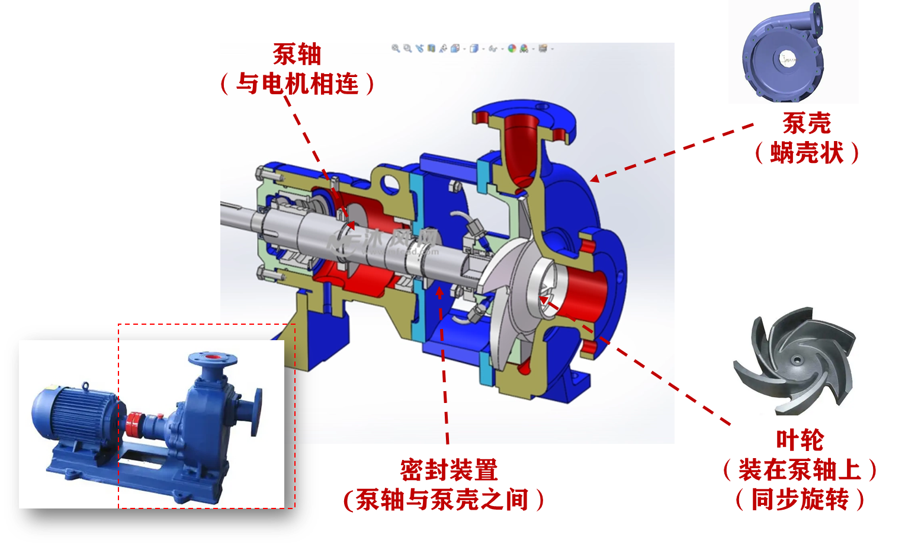{width=50%}

#### 工作原理

开动前灌满液体（防止气缚）$\to$ 电机轴带动叶轮旋转 $\to$ 液体受离心作用抛向外围，获得动能 $\to$ 液体高速进入泵壳，减速，动能转化为静压能，排出 $\to$ 叶轮中心形成真空，下方液体补充

> 气缚现象：泵内存在气体导致液体无法进入

### 离心泵主要构件的结构及功能

#### 叶轮

叶轮是离心泵的心脏部件，有2 $\sim$ 6片叶片，叶片弯曲。

- 闭式叶轮的内漏（倒流）较弱

> 内漏：有一部分获得能量的高压液体从叶片顶端与泵壳之间的间隙漏回吸入口

- 开式叶轮的内漏最大，效率最低

- 开式叶轮和半闭式叶轮不易发生堵塞现象

离开叶轮的一部分高压液体可能漏入叶轮后侧空腔中，而叶轮前侧液体吸入口压强低，会产生指向叶轮吸入口侧的轴向推力，引起叶轮的磨损与振动

#### 泵壳

作用：汇集并导出液体，动能转换为静压能的能量转换装置

由质量衡算，$u_0A_0=u_1A_1$，流动截面积逐渐增大，流速逐渐减小，动能转化为静压能。

#### 导轮

叶轮外周固定不动的带叶片的环

能够平缓改变流动方向，降低流速，减少损耗

#### 密封装置

可以分为填料密封和机械密封

填料密封：将泵轴穿过泵壳的环隙做成密封圈，向里面装入软填料（如浸油或涂石墨的石棉绳等）

机械密封：转轴装动环，泵壳装静环，两环的端面光滑，因为弹力贴紧作相对转动，密封效果更好（输送酸、碱、易燃、易爆、有毒液体等）

### 离心泵的主要性能参数

离心泵上有铭牌，记有：转速、流量、压头、轴功率和效率、允许汽蚀余量，这些称为离心泵的主要性能参数。

- 转速（$n$，rps 或 rpm）

- 流量（$Q$，m$^3$/s 或 m$^3$/h），泵单位时间内实际输出的液体量，流量计测定

- 压头/扬程（$H$，m），泵对单位重量流体提供的有效能量

- 轴功率（$N$，W 或 kW），有效功率 $N_e = m_sw_e = Q\rho gH$

- 效率（$\eta$，无量纲），$\eta = N_e/N$，$N = N_{电机输出}\eta_{传输} = N_{电机输入}\eta_{电机}\eta_{传输}$

- 允许汽蚀余量：参照后面某节

#### 理论压头与实际压头

泵的压头与影响因素的关系式只能由实验测定，但理想情况下的关系式则可理论推导得到。

流体为理想流体，泵内无摩擦损失；叶片数目无穷多且厚度忽略不计，流体与叶片相对运动的轨迹可视为与叶片形状相同。

此时得到的压头称为理论压头，表示理想情况下单位重量的液体所获得的能量，$H_{\infty}$

$$
H_{\infty} = \frac{p_2-p_1}{\rho g} + \frac{c_2^2-c_1^2}{2g}
$$

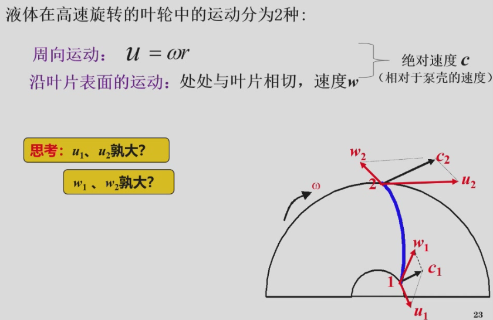{width=50%}

$$
H_{\infty} = \frac{u_2^2-u_1^2 + w_2^2-w_1^2}{2g} + \frac{c_2^2-c_1^2}{2g}
$$

由余弦定理：$w_1^2 = c_1^2 + u_1^2 - 2c_1u_1\cos \alpha_1$

$$
\therefore H_{\infty} = \frac{c_2u_2\cos \alpha_2 - c_1 u_1 \cos \alpha_1}{g}
$$

离心泵设计上，$\alpha_1 = \pi/2$，记 $c_{2u}$ 为 $u$ 方向分量，则：

$$
H_{\infty} = \frac{c_2u_2\cos \alpha_2}{g} = \frac{c_{2u}u_2}{g}
$$

$b_2$ 是叶轮宽度，有：

$$
\begin{cases}
Q = 2\pi r_2b_2c_{2r} \\
(u_2 - c_{2u})/c_{2r} = \cot \beta_2
\end{cases}
\Rightarrow c_{2u} = u_2 - \frac{Q}{2 \pi r_2 b_2}\cot \beta_2
$$

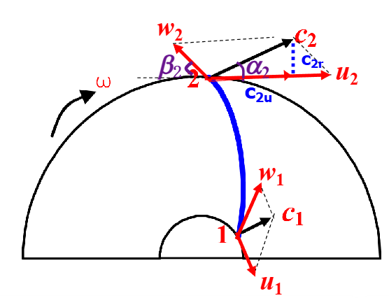{width=30%}

代入得：

$$
H_{\infty} = \frac{u_2}{g} (u_2 - \frac{Q}{2 \pi r_2 b_2}\cot \beta_2) = \frac{1}{g}(u_2^2 - \frac{Qu_2}{2 \pi r_2 b_2}\cot \beta_2) = \frac{1}{g}[{\omega r_2}^2 - \frac{Q\omega}{2 \pi b_2}\cot \beta_2]
$$

叶片后弯，$\beta_2 < 90^\circ$，$\cos\beta_2 < 0$，$Q$ 变大 $H$ 变小

叶片径向，$\beta_2 < 90^\circ$，$\cos\beta_2 < 0$，$H$ 与 $Q$ 无关

叶片前弯，$\beta_2 > 90^\circ$，$\cos\beta_2 > 0$，$Q$ 变大 $H$ 变大

实际上前弯叶片由于 $c_2$ 最大，机械能损失最大，设计上一般选后弯叶片，$\beta_2\approx25^\circ\sim30^\circ$

(4) 理论压头 $H_{\infty}$ 与液体密度无关。同一台泵无论输送何种密度的液体，对单位重量流体所能提供的能量是相同的。

实际压头会小于理论压头，原因如下：

- 叶片间的环流运动：叶片实际是有数目的，叶片间会出现涡流

- 阻力损失：阻力约与流速平方成正比

- 冲击损失：液流在入口或出口处会与叶片及泵壳发生碰撞，导致机械能损失。在设计流量下冲击损失最小，偏离越远则损失越大

#### 轴功率与效率

与效率 $\eta$ 有关的各种能量损失：

(1) 容积损失：内漏

(2) 水力损失：环流损失、阻力损失、冲击损失

(3) 机械损失：泵轴与轴承、密封圈等机械部件之间的摩擦

对小型水泵，$\eta$ 一般为50 $\sim$ 70% ；对大型泵，$\eta$ 一般可以达到 90% 以上

- 功率随直径 5 次方增长，损失增加更慢

- 大泵间隙相对小，泄漏相对小，容积效率高

- 大泵一般流量大，比转速高，圆盘摩擦损失小

### 离心泵的特性曲线

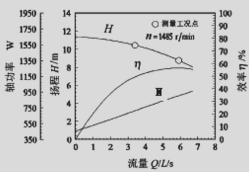{width=50%}

上述主要性能参数间的关系无法理论推得，一般由生产厂家测定，用曲线图表示，称为离心泵特性曲线。

常用有三条线：$H-Q$ 线（平坦型、陡降型、驼峰型）；$N-Q$ 线；$\eta-Q$ 线。

测定条件是固定转速，20$^\circ\text{C}$ 清水

> 由图，离心泵启动时出口应关闭，减小 $Q$，防止烧坏电机

#### 影响因素

(1) 液体性质

- 密度：只影响 $N$，$N = \frac{Q \rho gH}{\eta}$，$\rho$ 增大，$N-Q$ 线上移

- 黏度：当 $\mu$ 大于 20$^\circ\text{C}$ 清水时，$\mu$ 越大，$H$ 越小，$Q$ 越大，$\eta$ 越小；实验表明，当 $\mu$ 小于 20$^\circ\text{C}$ 清水的 **20倍** 时，可忽略不计。

(2) 叶轮转速

当转速 $\omega$ 变化不大时（20%以内），利用前述理论压头推导的出口三角形近似假定，有：

$$
\frac{Q'}{Q} = \frac{n'}{n} \qquad \frac{H'}{H} = (\frac{n'}{n})^2
$$

若 $\eta$ 不变，有比例定律：*【注意只能用于泵的特性曲线】*

$$
\frac{N'}{N} = (\frac{n'}{n})^3
$$

> 注意：

> 若泵在原转速 $n$ 下的特性曲线为 $H = A+BQ^2$，代入比例定律，则新转速 $n'$ 下有：

> $$
> (\frac{n}{n'})^2 H' = A + B (\frac{n}{n'})^2 Q'^2
> $$

> $$
> H' = A(\frac{n'}{n})^2 + B Q'^2
> $$

(3) 叶轮直径

当叶轮直径因切割而变小时，若变化小于 20%，有：

$$
\frac{Q'}{Q} = \frac{D_2'}{D_2} \qquad \frac{H'}{H} = (\frac{D_2'}{D_2})^2
$$

若 $\eta$ 不变，有切割定律：

$$
\frac{N'}{N} = (\frac{D_2'}{D_2})^3
$$

与上一小点相同，若原直径 $D_2$ 下的特性曲线为 $H=A+BQ^2$，新直径 $D_2'$ 下的特性曲线为 $H' = A(\frac{D_2'}{D_2})^2 + BQ^2$

### 离心泵的工作点与流量调节

在管路中，需要有以下匹配（计算原理）：

泵提供的流量要与管路所需的流量匹配；泵提供的压头 $H$ 要与管路所需的压头 $h_e$ 匹配。

$$
h_e = (\Delta z + \frac{\Delta p}{\rho g}) + (\frac{\Delta u^2}{2g} + \sum h_f) = A + f(Q)
$$

完全湍流时，由 Moody 图，$\lambda$ 近似为常数，有：

$$
\frac{\Delta u^2}{2g} + \sum h_f = (1 + \lambda \frac{l + l_e}{d}) \frac{8}{\pi^2 d^4 g} Q^2 = B Q^2
$$

即：

$$
h_e = A + B Q^2
$$

这就是管路特性方程。

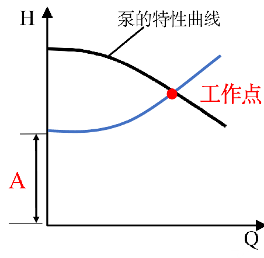{width=30%}

当阀门关小时，$l_e/d \uparrow$，曲线上弯，工作点向左上移动；当阀门开大时，反之。

### 离心泵的安装高度

#### 安装高度

泵轴与吸液方液面间的垂直高度，称为安装高度，用 $Z_s$ 表示。可正可负。

汽蚀现象：当 $p_K＝p_v$（饱和蒸气压）时，K处发生 **部分汽化** 现象。可能造成以下后果：叶片表面产生蜂窝状腐蚀；泵体震动，并发出噪音；流量、压头、效率都明显下降；严重时甚至吸不上液体。

为避免汽蚀现象，安装高度必须加以限制，即存在最大安装高度 $Z_{S,max}$。

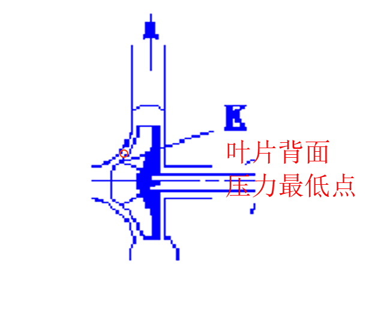{width=30%}

#### 汽蚀余量的物理意义

汽蚀取决于泵内 K 点的局部静压。工程上不容易直接测量该位置，因此用泵入口 e 处的总压头来评价吸入条件。液体进入泵内后，局部静压还会降低，因此入口需要留出一定余量。

$$
\Delta h = \frac{p_e}{\rho g} + \frac{u_e^2}{2g} - \frac{p_v}{\rho g}
$$

#### 允许汽蚀余量

以扬程较正常值下降 $3\%$ 作为试验判据。

$$
\Delta h_{min} = \frac{p_{e,min}}{\rho g} + \frac{u_e^2}{2g} - \frac{p_v}{\rho g}
$$

$$
\Delta h_{允许} = \Delta h_{min} + 0.3\text{m}
$$

安装时要求，$\Delta h \ge \Delta h_{允许}$

#### 允许安装高度的推导

从液面至泵口列机械能衡算：

$$
\frac{p_s}{\rho g} = Z_S + \frac{p_e}{\rho g} + \frac{u_e^2}{2g} + \sum h_f
$$

$$
\Delta h = \frac{p_s - p_v}{\rho g} - Z_S - \sum h_f
$$

$$
Z_S \le Z_{S,允许} = \frac{p_s - p_v}{\rho g} - \sum h_f - \Delta h_{允许}
$$

可见安装高度越大、吸入管损失越大，入口汽蚀余量越小。

### 离心泵的类型、选用、安装与操作

{width=30%}

选用规则：根据流体性质和操作条件定类型，根据流量、压头大小、高效区定规格

## 其他类型泵

{width=40%}

### 往复泵

往复泵由泵缸、活塞、阀门、传动机构组成，利用容积的变化给流体加静压能，一次吸液一次排液为一个工作循环。

- 启动前不需要灌液，低压是因为工作室的扩张，可以自吸。

- 安装高度一样有限制，也会出现汽蚀。

- 流量主要由单位时间内活塞扫过的体积决定，特性曲线见下图。

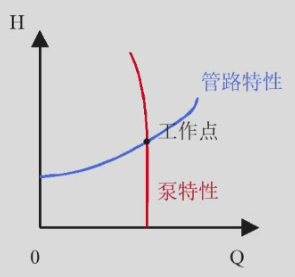{width=20%}

- 流量不可以用出口阀调节，可以用旁路（理解为分流器回流）调节，也可以改变活塞行程或往复次数。

- 输液量不连续、不均匀，适用于运输小流量、高压头、高粘度的液体。

- 效率更高，通常为 $72 \sim 93 \%$。

为使运输连续、均匀，可采用单缸双动（相位差 $=\pi/2$）、多缸泵（相位差 $<\pi/2$）。

### 各类泵在化工生产中的应用

离心泵应用范围最广。特别适用于化工生产的原因是它的流量均匀而易于调节，又能输送有腐蚀性、含悬浮物的液体。

往复泵的突出优势是能够提供较高压头，实际选用时应结合流量要求，与离心泵、旋转泵等进行比较。

## 通风机、鼓风机、压缩机和真空泵

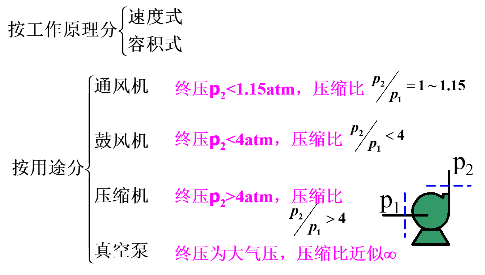{width=50%}

### 离心通风机

结构与离心泵相似，叶片数目多、短，有径向、前弯、后弯等，通道多呈矩形；工作原理与离心泵相同；主要性能参数：风量、风压、静风压、轴功率、效率。

#### 风压

又称全风压，用 $p_t$ 表示，每立方米气体通过风机所获得的能量，J/m$^3$

在风机出入口间列机械能衡算（认为气体不可压缩，$\rho$ 不变）：

$$
p_t = \rho g H_t = (p_2 - p_1) + (\frac{\rho}{2}(u_2^2 - u_1^2))
$$

取 $p_1$ 表压，为 $0$；$u_1 = 0$，则：

$$
p_t = p_2 + \frac{\rho_2 u_2^2}{2}
$$

标准全风压 $p_{t0}$ 是用 1 atm、20 $^circ$C 的空气测定的，非标准条件下的风压需要换算：

$$
\frac{p_t}{p_{t0}} = \frac{\rho}{1.2}
$$

#### 功率与效率

功率用 $N$ 表示，效率用 $\eta$ 表示：

$$
N = \frac{\rho g Q H_t}{\eta} = \frac{Q p_t}{\eta} \qquad \eta \approx 70\% \sim 90\%
$$

### 往复式压缩机

压缩机也分为离心式与往复式，主要介绍往复式。

往复式压缩机的结构、工作原理与往复泵相似。但因气体密度小、可压缩的特性，决定了压缩机的阀门更加轻巧、灵活。

一次工作由四步构成：压缩-排气-膨胀-吸气

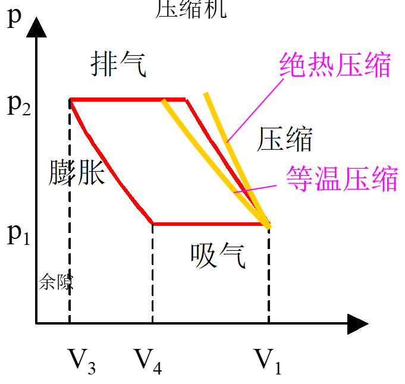{width=30%}

由于余隙的存在，压缩比 $p_2/p_1$ 过大时，图中膨胀段会很长，$V_4$ 很大，导致新鲜吸气量 $V_1 - V_4$ 很小。因此压缩比一般取 $5\sim7$，更大的压缩比需要使用多级压缩。

在一个气缸里压缩了一次的气体，送入中间冷却器冷却之后再送入次一气缸进行压缩，经几次压缩再达到所需的终压。 

压缩机的级数愈多，构造便愈复杂，因此常用的多为2至6级，每级压缩比约为3至5。

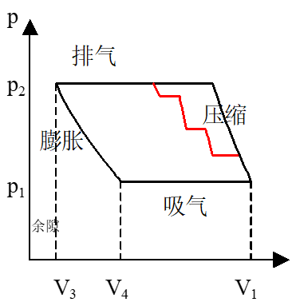{width=30%}

## 小结

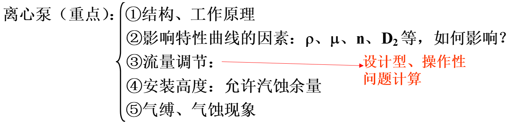{width=50%}

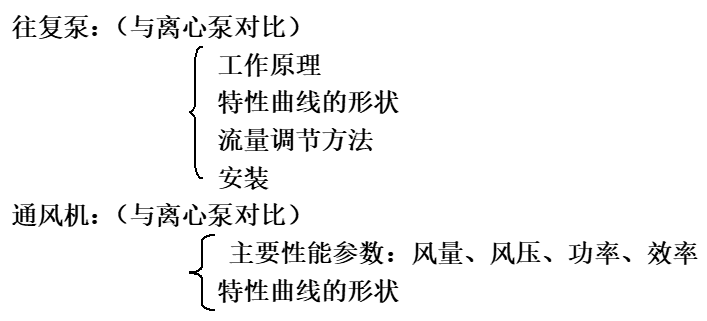{width=40%}