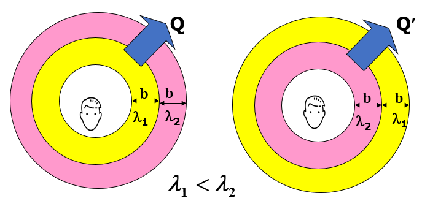
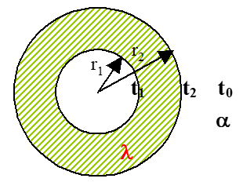
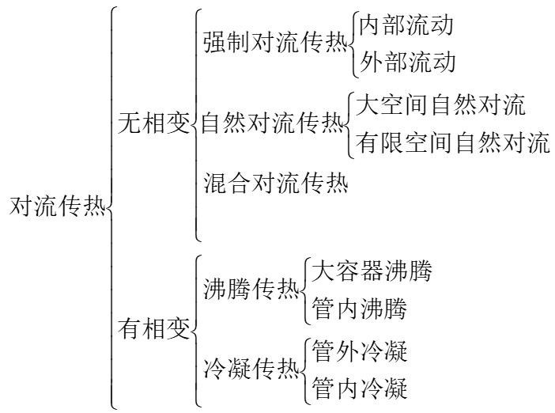
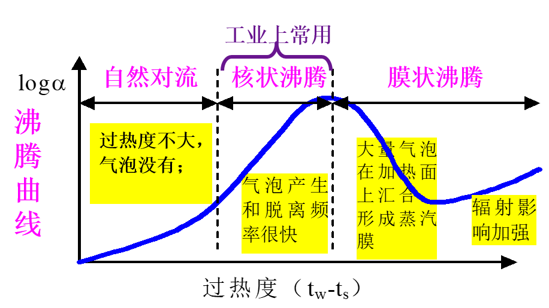

# 第五、六章 热量传递基础及设备

## 概述

传热有三种方式：

- 热传导

发生在相互接触的物质之间、静止的物质内部、层流流动的物质内部。

热传导机理：(气体)分子或原子的无规则热运动；(固体)金属的自由电子，非金属的晶格振动/声子振动；(液体)两种观点，教材 P134

- 对流

分为自然对流（流体内部），强制对流（流体宏观位移）。有牛顿冷却定律：

$$
Q = \alpha A(t_1 - t_2)
$$

$\alpha$ 称为对流传热系数/给热系数，W/(m$^2\cdot$K)

- 辐射

## 热传导

### 傅里叶定律

#### 傅里叶定律的基本概念

- 传热速率（$Q$，J/s），单位时间传递的能量

- 热通量（$q$，J/(m$^2\cdot$s)），单位传热面积上的传热速率，是矢量，方向为传热面的法线方向

$$
\vec{q} = \frac{d Q}{d \vec{A}}
$$

- 等温面，温度相同的点组成的面

- 温度变化率（$\Delta t / \Delta l$），两等温面的温差与两等温面间的任一距离之比

- 温度梯度（$\partial t / \partial \vec{n}$），两等温面的温差与两等温而间的法向距离（最短）之比，垂直于等温面，以温度升高的方向为正方向

#### 傅里叶定律的形式

$$
\vec{q} = \frac{d Q}{d \vec{A}} = - \lambda \frac{\partial t}{\partial \vec{n}}
$$

负号表示 $\vec{q}$ 与温度梯度方向相反，$\lambda$ 称为热导率/导热系数，属于物理性质，单位 W/(m$\cdot$K)

### 热导率

物理含义：代表单位温度梯度下的热通量大小，故物质的 $\lambda$ 越大，导热性能越好。

一般地，导电固体的 $\lambda$ 大于非导电固体，液体的 $\lambda$ 大于气体。教材 P137

影响因素：与物质种类、$T$、浓度有关，一般与 $p$ 无关

随着 $T$ 的提高，气体、水、甘油、非金属的 $\lambda$ 提高，其他液体、金属的 $\lambda$ 降低。

获取方法：查阅相关物性数据手册，如教材附录二 $\sim$ 四 

### 一维稳态平壁热传导

#### 无限大单层平壁一维稳态导热（无内热源）

- 特点：属于一维导热，$A,\ Q,\ q$ 均为常数

$$
Q = qA = - \lambda A \frac{\partial t}{\partial n} = - \lambda A \frac{dt}{dx} = \text{const.}
$$

若 $\lambda$ 也是常数，上式可化为：

$$
\frac{dt}{dx} = \text{const.} = \frac{t_2 - t_1}{b}
$$

式中 $b$ 为壁厚，可见在壁内温度线性分布。

$$
Q = qA = \frac{t_1 - t_2}{b/\lambda A} = \frac{\text{推动力}}{\text{热阻}}
$$

#### 无限大多层平壁一维稳态导热（无内热源）

- 特点：属于一维导热，$A,\ Q,\ q$ 均为常数，通过每一层的 $Q,\ q$ 都相同

对第 $i$ 层有：

$$
Q = qA = \frac{t_i - t_{i+1}}{b_i/\lambda_i A}\ \Rightarrow \ \frac{Q b_i}{\lambda_i A} = t_i - t_{i+1}
$$

上式左右可以直接加和，因此有和比定理：

$$
Q = \frac{t_1 - t_{n+1}}{\sum_{i=1}^n b_i/\lambda_i A}
$$

若上述平壁的右侧与环境进行对流传热，设环境温度为 $t_0$、对流传热系数为 $\alpha$，已知对流传热附从牛顿冷却定律 $Q = \alpha A (t_{n+1} - t_0)$，则传热量为：

$$
Q = \frac{t_1 - t_{n+1}}{\sum_{i=1}^n b_i/\lambda_i A} = \frac{t_{n+1} - t_0}{\frac{1}{\alpha A}} = \frac{t_1 - t_0}{\sum_{i=1}^n b_i/\lambda_i A + \frac{1}{\alpha A}} = \frac{\text{总推动力}}{\text{总热阻}}
$$

### 一维圆筒壁稳态热传导

#### 无限长单层圆筒壁一维稳态导热（无内热源）

- 特点：属于一维导热，$Q$ 为常数，$A,\ q$ 不是常数

$$
\left.
    \begin{aligned}
    Q &= qA = - \lambda A \frac{dt}{dr} = \text{const.} \\
    A &= 2 \pi r L \\
    \end{aligned}
\right\} \Rightarrow dt = - \frac{Q}{2 \pi rL \lambda} dr
$$

在 ($t_1,\ t_2$) 内积分有：

$$
t_1 - t_2 = Q \frac{\ln r_2/r_1}{2 \pi L \lambda} \qquad Q = \frac{t_1 - t_2}{\frac{\ln r_2/r_1}{2 \pi L \lambda}} = \frac{\text{推动力}}{\text{热阻}}
$$

为了将传热量的表达形式统一，我们引入对数平均半径：

$$
r_m = \frac{r_2-r_1}{\ln r_2/r_1}
$$

因此有：(注意 $b$ 为壁厚)

$$
\frac{\ln r_2/r_1}{2 \pi L \lambda} = \frac{r_2-r_1}{2 \pi L \lambda[(r_2-r_1)/\ln r_2/r_1]} = \frac{b}{2 \pi L \lambda r_m} = \frac{b}{\lambda A_m}
$$

#### 无限长多层圆筒壁一维稳态导热（无内热源）

既然我们已经统一了平壁与圆筒传热的形式，自然可以使用和比定理：

$$
Q = \frac{t_1 - t_{n+1}}{\sum_{i=1}^n (b_i/\lambda_i A_{mi})}
$$

e.g.1: 气温下降，应添加衣服，应把保暖性好的衣服穿在里面好，还是穿在外面好？

{width=40%}

解：因为 $Q=$温差/热阻，只需要比较两种情形的热阻 $R,\ R'$

设人体抽象成的圆筒半径为 $r_1$；更保暖的材料厚度为 $b_1$，热导率为 $\lambda_1$；更不保暖的材料厚度为 $b_2$，热导率为 $\lambda_2$。统一规定 $r_2 = r_1 + b_{内}$，$r_3 = r_1+b_1+b_2$。

$$
R = \frac{\ln(r_2/r_1)}{2 \pi L \lambda_1} + \frac{\ln(r_3/r_2)}{2 \pi L \lambda_2} \qquad 
R' = \frac{\ln(r_2'/r_1)}{2 \pi L \lambda_2} + \frac{\ln(r_3/r_2')}{2 \pi L \lambda_1}
$$

$$
R - R' = \frac{\ln(r_2/r_1)-\ln(r_3/r_2')}{2 \pi L \lambda_1} + \frac{\ln(r_3/r_2)-\ln(r_2'/r_1)}{2 \pi L \lambda_2} = \frac{(\lambda_2-\lambda_1)\ln(r_2r_2'/r_1r_3)}{2 \pi L \lambda_1 \lambda_2}
$$

$$
\because \lambda_2 > \lambda_1, \qquad \frac{r_2r_2'}{r_1r_3} = \frac{(r_1+b_1)(r_3-b_1)}{r_1r_3} = \frac{r_1r_3+b_1(r_3-r_1-b_1)}{r_1r_3} = \frac{r_1r_3+b_1b_2}{r_1r_3} > 1
$$

$$
\therefore R>R',\qquad Q<Q'
$$

e.g.2: 圆管保温层越厚（“衣服”越厚），保温效果越好吗？

{width=25%}

解：保温层传热阶段有：

$$
t_1 - t_2 = Q \frac{\ln(r_2/r_1)}{2 \pi L \lambda}
$$

保温层外侧自然传热（牛顿冷却定律）有：

$$
t_2 - t_0 = Q \frac{1}{2 \pi r_2 L \alpha}
$$

相加，变形得：

$$
Q = \frac{t_1 - t_0}{\frac{\ln(r_2/r_1)}{2 \pi L \lambda} + \frac{1}{2 \pi r_2 L \alpha}}
$$

$$
r_1 = \text{const.},\qquad \frac{dQ}{dr_2} = -\frac{t_1 - t_0}{\left(\frac{\ln(r_2/r_1)}{2 \pi L \lambda} + \frac{1}{2 \pi r_2 L \alpha}\right)^2} \left( \frac{1}{2 \pi r_2 L \lambda} - \frac{1}{2 \pi r_2^2 L \alpha} \right)
$$

$$
\frac{dQ}{dr_2} = 0 \Rightarrow r_2 = \frac{\lambda}{\alpha},\quad \text{记为临界半径}\ r_c
$$

### 接触热阻

是两固体之间由于未紧密接触而导致的热阻。

影响因素：

- 接触材料的种类及硬度，

- 接触面的粗糙程度，

- 接触面的压紧力，

- 空隙内的流体性质。

接触热阻一般通过实验测定或凭经验估计。

## 对流传热

边界层，特别是层流底层是对流传热的主要热阻所在。对流传热的热通量近似等于边界层流体的热传导通量。

{width=40%}

牛顿冷却定律：

$$
Q = \alpha A (t-t_w) = \frac{t - t_w}{1/\alpha A}
$$

上式形式与平壁传热相似，$Q=$ 推动力/热阻。

$\alpha$ 获得的主要方法有：

- 理论分析法：建立描述流动与传热的数学方程。简单问题可求解析解，复杂问题可采用数值方法求解。

- 实验方法：用量纲分析法、再结合实验，建立经验关系式。

### 实验法求 $\alpha$

影响 $\alpha$ 的因素主要有：

- 引起流动的原因：自然对流和强制对流

- 流动型态：层流或湍流

- 流体的性质：$\rho$、$\mu$、$C_p$、$\lambda$ 等

- 传热面的形状、大小、位置：如圆管与平板、垂直与水平、管内与管外等

- 有相变与无相变：$C_p$ 或汽化潜热 $r$

整理得到：

$$
\alpha = f(\rho, \mu, C_p(或 r), \lambda, l, \beta\Delta tg(或 u))
$$

同第一章得无因次数群：

- 努塞尔数，表示导热热阻（假设流体完全静止时）与对流热阻之比

$$
Nu = \frac{\alpha l}{\lambda}
$$

- 普朗特数，反映物性的影响。一般地，气体的Pr<1，液体的Pr>1 

$$
Pr = \frac{C_p \mu}{\lambda}
$$

- 雷诺数，表示惯性力与黏性力之比

$$
Re = \frac{\rho u l}{\mu}
$$

- 格拉晓夫数，反映温差引起的自然对流强度，在自然对流关联式中的作用类似于强制对流中的雷诺数

$$
Gr = \frac{\beta \Delta t g l^3 \rho^2}{\mu^2}
$$

综上可以得到：

$$
Nu = F(Re(或 Gr), Pr)
$$

定性温度：确定物性的温度，有两种

- 主体平均温度：$t_m = (t_{进} + t_{出})/2$

- 膜温：$t_m = (t_{壁} + t_{主体})/2$

### 各种情形下的 $\alpha$ 经验式

#### 无相变时

(A) 管内层流

传热主要以导热方式为主（有时有自然对流）

$$
Nu = 1.86 \left( Re Pr \frac{d}{L} \right)^{1/3} \left( \frac{\mu}{\mu_w} \right)^0.14
$$

使用范围与取值说明：

- 圆形直管，恒壁温，管内层流的进口段。

- $Re<2300,\ 0.6<Pr<6700,\ RePr(d/l)>10$

- $Gr<25000$ 时，可忽略自然对流的影响。

- $\mu_w$ 按壁温取值，其余物性按流体进、出口温度的算术平均值取值；特征尺寸取管内径 $d$。

当 $Gr>25000$，需考虑自然对流对传热的影响，上式乘上一个大于1的校正系数：

$$
f = 0.8 \left( 1+0.015Gr^{1/3} \right) > 1
$$

(B) 管内湍流

$$
Nu = 0.023 Re^{0.8} Pr^n
$$

液体被加热时 $n=0.4$，液体被冷却时 $n=0.3$

适用范围：

- 光滑管
- $Re>10^4,\ 0.6<Pr<160$
- 充分发展段，即L/d>50
- 温差（$t_w-t$）较小

定性温度：$t_m = (t_{进} + t_{出})/2$

定性尺寸：管内径

为什么加热时 $n$ 取0.4，冷却时取0.3？

原因：温度对层流底层中液体黏度的影响不同：液体被加热时，近壁液体温度较高、黏度较小，层流底层变薄，$\alpha$ 变大；液体被冷却时，近壁液体温度较低、黏度较大，层流底层较厚，$\alpha$ 变小

若不满足适用范围时，需修正： 

- 对于短管，$L/d<50$：$f_1$，见教材图(5-25)

- 当壁面与流体主体温差较大时，需引入一个校正项：$Nu = 0.027 Re^{0.8} Pr^{0.33} \left( \frac{\mu}{\mu_w} \right)^{0.14}$

- 过渡流：$f_2=1-(6\times10^5)/(Re^{1.8})$

- 弯管内：$\alpha'=[1+(1.77d)/R]\alpha$

- 非圆形管的强制湍流：将 $d$ 换成 $d_e$

(C) 管外强制对流

- 流体横向流过单管传热，见教材图(5-71)，$\alpha$ 处处不同，需要取平均

- 流体横向流经管束（管簇）的传热：$Nu = C_1 C_2 Re^n Pr^{0.4}$，$C_1,\ C-2,\ n$ 的值见教材表(5-11)

- 流体在管壳间的对流传热：有挡板，$Re>100$ 即可达到湍流。$Nu = 0.36 Re^{0.55} Pr^{1/3} \left( \frac{\mu}{\mu_w} \right)^{0.14}$

(D) 自然对流（大空间，边界层不受干扰）

$$
Nu=C(GrPr)^n
$$

$C,\ n$ 为经验常数，见教材表(5-12)

#### 有相变时

(A) 冷凝传热

膜状冷凝是更常见的形式，具体公式推导见教材 P178-179，选学内容

管内层流：式(5-79)、(5-79b)；管内湍流：式(5-82)；管外层流：式(5-80)

(B) 沸腾传热（大面积沸腾）

指将加热表面浸没在相对静止且容积远大于加热体尺寸的液体中所发生的沸腾现象。在此过程中，流体的运动只是由于自然对流和气泡扰动引起。

- 产生沸腾现象的必要条件：液体过热、有汽化核心

- 沸腾传热机理：气泡的不断形成、长大、脱离壁面，热量随气泡被带入液体内部；同时引起液体的搅动。

- 大容积沸腾传热的沸腾曲线

{width=40%}

- 核状沸腾传热系数的主要影响因素：

    (i) 表面粗糙度：粗糙表面 $\alpha$ 大，但粗糙度达到一定极限后，就基本上没影响了。

    (ii)过热度：$\alpha$ 与 $\Delta t$ 的2~3次方成正比。

    (iii)其它：操作压力、液体性质、加热面布置（P187）

## 辐射传热

### 辐射传热的基本概念

#### 什么是辐射传热？

靠电磁波传热的方式称为辐射传热，工程传热中主要关注约 0.4~40 微米波段的热辐射（可见光，近红外）

#### 吸收率、反射率、透过率

总传热功率 $Q = Q_A + Q_R + Q_D$

- 吸收率：$A' = Q_A/Q$

- 反射率：$R = Q_R/Q$

- 透过率：$D = Q_D/Q$

#### 黑体、白体、透热体、灰体

吸收率 $A'=1$ 的物体称为绝对黑体，没有光泽的黑漆可以近似看作黑体（0.96~0.98）

反射率 $R=1$ 的物体称为绝对白体或镜体，如十分光亮的金属（~0.97）

透过率 $D=1$ 的物体称为透热体，如工业常见的温度范围内的单原子或对称双原子构成的气体（如 He，H$_2$，O$_2$ 等）

实际物体的辐射特性过于复杂，工程上为方便处理，以灰体近似替代实际物体。

灰体指以相同吸收率吸收所有波长的热辐射能的物体。工业上用的大多数物体可近似为灰体。

### 物体的辐射（发射）能力

单位时间、单位面积上对所有波长辐射线的辐射能量称为物体的辐射（发射）能力，用 $E$ 表示，单位 W/m$^2$

由于黑体吸收效率最高，为保持温度不变，必须将等量的能量发射出去，因此其发射效率也最高。

#### 黑体的辐射能力

$$
E_b = \int_{0}^{\infty} E_{b\lambda} d\lambda
$$

$$
E_{b\lambda} = \frac{C_1 \lambda^{-5}}{\exp{C_2/\lambda T}-1}
$$

$$
\Rightarrow E_b = \sigma_0 T^4 = C_0 \left( \frac{T}{100} \right)^4
$$

式中 $T$ 以 K 计，$\sigma_0 = 5.669 \times 10^{-8}$ W/(m$^2$·K$^4$)，$C_0 = 5.669$ W/(m$^2$·K$^4$)

#### 灰体的辐射能力

定义黑度（或辐射率）：

$$
\varepsilon = \frac{E}{E_b}
$$

#### 克希霍夫定律

假定有一灰体壁面，一黑体壁面，两壁面均无限大且相距很近，假设透过率为 0；灰体温度为 $T_1$，黑体温度为 $T_2$

黑体发射 $E_b$；灰体吸收 $A'E_b$，反射 $(1-A')E_b$，发射 $E$。对两壁面中间某平行界面作能量衡算：

$$
E_b = E + (1-A')E_b \Rightarrow \varepsilon = A'
$$

### 气体热辐射的特点

Q1: 在常规工况的气体红外辐射传热计算中，主要考虑不对称双原子气体和多原子气体的辐射；单原子或对称双原子气体近似视为透热介质，为什么？

A1: 分子的转动或者振动若能引起电偶极矩的变化，就可以吸收或发射相应波段的红外辐射。

Q2: 气体只在某些波段范围内具有热辐射能力（见教材P194 表(5-15)），为什么？

A2: 分子的振转能级是不连续的，只能在允许的能级之间跃迁。

Q&A3: 气体的热辐射发生在整个体积内，而不是在表面，且沿程变化。

### 辐射、对流的联合传热

$$
Q = \alpha_c A(t_w - t_{\infty}) + \alpha_R A(t_w - t_{\infty}) = \alpha_T A(t_w - t_{\infty})
$$

其中辐射传热量为：

$$
\varepsilon_1 A (E_{b1}-E_{b2}) = \varepsilon_1 A C_0 [(t_w/100)^4 - (t_{\infty}/100)^4] = \alpha_R A(t_w - t_{\infty})
$$

## 间壁式换热器的传热

换热器：利用多股物料的温差实现物料热量传递的设备

- 控制温度，满足流体输送、反应、分离、排放的需求

- 充分利用原料和产物的热量，减少能源消耗

### 换热器简介

换热器分为直接接触式（适用于允许流体混合的情况，结构简单易防腐）、间壁式（热量通过壁面传递，最广泛）、蓄热式（耐高温，体积大，流体存在混合，用于气体余热回收）

【间壁式分类占位】

【间壁式类型示意图占位】

### 间壁式换热器的传热过程分析

我们约定，热流体一侧的温度为 $T_i$，冷流体侧的温度为 $t_i$；进口温度 $i=1$，出口温度 $i=2$

传热分为 3 个环节：热流体到壁的对流、壁内的导热、壁到冷流体的对流

- 热流体侧的对流传热：$Q=\alpha_1 A (T-T_w)$

- 间壁导热：$Q=(T_w-t_w)/(b/\lambda A_m)$

    边界层是传热的主要热阻所在。

- 冷流体侧的对流传热：$Q=\alpha_1 A (t_w-t)$

#### 总传热速率方程

同取微元：

$$
dQ = \frac{T-T_w}{1/\alpha_1 dA_1} = \frac{T_w-t_w}{b/\lambda dA_m} = \frac{t_w-t}{1/\alpha_2 dA_2} = \frac{T-t}{1/\alpha_1 dA_1 + b/\lambda dA_m + 1/\alpha_2 dA_2} = \frac{T-t}{1/K' dA}
$$

$$
Q = \int_1^2 K' \Delta t dA = K' A \Delta t_m = \frac{\Delta t_m}{1/K'A}
$$

#### 热量衡算方程（$Q$ 的计算）

(传递的热量速率) = 热流体放出的热量速率 = 冷流体吸收的热量速率

$$
\begin{aligned}
    Q &= m_{s1}(H_{h1} - H_{h2}) = m_{s1}C_{p1}(T_1-T_2) \\
      &= m_{s2}(H_{c1} - H_{c2}) = m_{s1}C_{p2}(t_1-t_2) \\
      &= m_s r \\
\end{aligned}
$$

#### $K'$ 的计算

- 虽然温度在变化，工程上常基于某一定性温度将 $\alpha$ 视为常数

- $\lambda$ 是间壁材料的物性，工程计算常视为常数

$$
\Rightarrow \frac{1}{KA} = \frac{1}{\alpha_1 A_1} + \frac{b}{\lambda A_m} + \frac{1}{\alpha_2 A_2}
$$

工程上通常采用管外面积基准，$A = A_2$

$$
\Rightarrow \frac{1}{K} = \frac{A_2}{\alpha_1 A_1} + \frac{bA_2}{\lambda A_m} + \frac{1}{\alpha_2}
$$

考虑到实际传热时，间壁两侧还有污垢热阻，上式变为：

$$
\frac{1}{K} = \frac{A}{\alpha_1 A_1} + R_{s1}\frac{A}{A_1} + \frac{bA_2}{\lambda A_m} + R_{s2}\frac{A}{A_2} + \frac{A}{\alpha_2 A_2}
$$

若等号右侧有一项热阻特别大，则这一项称为控制热阻，$K$ 的值主要受这一项影响。设法减小控制热阻的值，可以显著改善换热器的传热效率。

#### $\Delta t_m$ 的计算

(A) 恒温差传热（两侧均有相变）

由于 $\Delta t$ 恒定不变，有：

$$
\Delta t_m = T - t
$$

(B) 变温差传热

【四种情况图片占位】

符号约定：$\Delta t_1$、$\Delta t_2$ 分别表示换热器两端的冷热流体温度差，不是某一股流体的进出口温度差

下面以冷、热流体均无相变、逆流流动为例，假定比热和 $K$ 为常量，换热器无散热损失：

$$
\left.
    \begin{aligned}
        dQ &= - m_{s1} C_{p1} dT \Rightarrow \frac{dT}{dQ} = -\frac{1}{m_{s1} C_{p1}} \\
        dQ &= - m_{s2} C_{p2} dt \Rightarrow \frac{dt}{dQ} = -\frac{1}{m_{s2} C_{p2}} \\
    \end{aligned}
\right\}
\Rightarrow \frac{d(T-t)}{dQ} = \frac{1}{m_{s2} C_{p2}} - \frac{1}{m_{s1} C_{p1}} = -B
$$

$$
\therefore \frac{d \Delta t}{-B} = dQ = K \Delta t A Rightarrow \ln\left( \frac{\Delta t_2}{\Delta t_1} \right) = -BKA
$$

$$
d \Delta t = -B dQ \Rightarrow \int_{\Delta t_1}^{\Delta t_2} d \Delta t = -B \int_{0}^{Q} dQ \quad \frac{\Delta t_2 - \Delta t_1}{Q} = -B
$$

$$
\Rightarrow Q = KA\frac{\Delta t_1 - \Delta t_2}{\ln(\Delta t_1/\Delta t_2)}
$$

从而我们得到逆、并流均适用的对数平均温差：

$$
\Delta t_m = \frac{\Delta t_1 - \Delta t_2}{\ln(\Delta t_1/\Delta t_2)}
$$