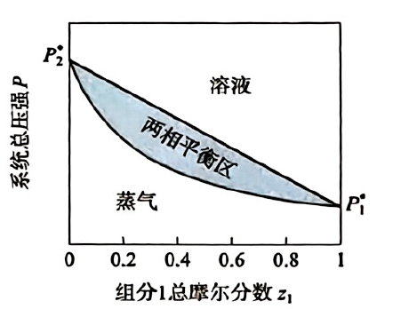
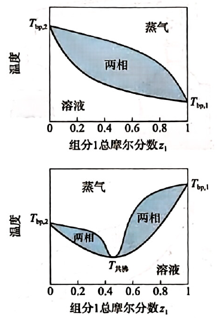
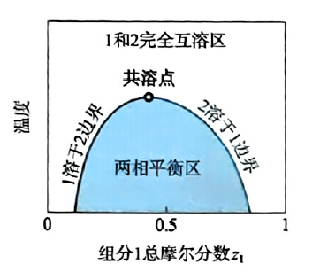
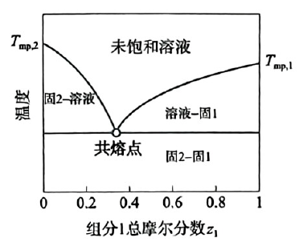
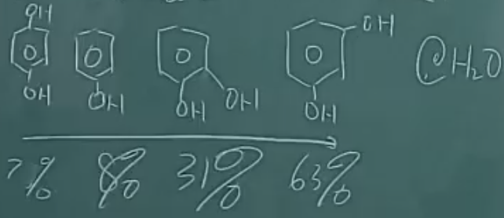

# 第十章：溶液与多相混合物

## 多相混合物的相平衡与相律

### 混合物相平衡

以某两种含 $C$ 种组分的均相混合物 $A$ + $B$ 为例，对每个组分（以第 $i$ 个组分为例）都有：

$$
i(A) \rightleftharpoons i(B)
$$

$$
d \xi_i = dn_{i(A)} = dn_{i(B)}
$$

$$
\Big(\frac{\partial G}{\partial \xi_i}\Big)_{T, p, n \ne n_i}\Bigg|_{平衡} = 0
$$

$$
\because G = \sum_{i(A)} n_{i(A)}\mu_{i(A)} + \sum_{i(B)} n_{i(B)}\mu_{i(B)}
$$

$$
\therefore \Big(\frac{\partial G}{\partial \xi_i}\Big)_{T, p, n \ne n_i}\Bigg|_{平衡} = -\mu_{i(A)} + \mu_{i(B)}
$$

即平衡时有：

$$
\mu_{i(A)} = \mu_{i(B)}
$$

对于有 $P$ 个相的系统，有：

$$
\mu_{i(A)} = \mu_{i(B)} = \dots = \mu_{i(P)}
$$

回到任意两相的 $C$ 个组分，

$$
\mu_{1(A)} = \mu_{1(B)} \ \dots \ \mu_{i(A)} = \mu_{i(B)} \ \dots \ \mu_{C(A)} = \mu_{C(B)}
$$

### 吉布斯相律

$$
G = f(T, p, n, \chi_1, \chi_2, \dots, \chi_{(C-1)})
$$

其中 $n$ 与相平衡无关。

对任意一相，$F_{A相} = 2 + C - 1$；对 $P$ 个相，$F_{相极大} = 2 + (C-1)P$

已知相平衡的每个等式都可以消去一个自由度，因此对 $C$ 组分 $P$ 相有：

$$
F = 2 + (C - 1)P - C(P - 1) = 2 + C - P
$$

考虑纯态，

$$
P_{min} = 1 \qquad F_{相} = 2 + 1 - 1 = 2
$$

$$
P = 3 \qquad F = 2 + 1 - 3 = 0 \Rightarrow 三相点固定
$$

$$
P = 2 \qquad F = 2 + 1 - 2 = 1 \Rightarrow 两相平衡成线
$$

### 理想混合物的二组分气-液平衡相图 p-z

$$
F = 1 + C - P = 2 \quad (p, z_1)
$$

对稳定气相，$z_1 = \tau_1$；对稳定液相，$z_1 = \chi_1$；对三个稳定相，$z_1 = \frac{n_{1(A)} + n_{1(B)}}{n_1 + n_2}$

$$
\left\{
    \begin{aligned}
        &\chi_1 p_1^* = p_1 = \tau_1 p (平衡条件) \\
        &p = p_1 + p_2 = \chi_1 p_1^* + (1-\chi_1)p_2^* = (p_1^* - p_2^*)\chi_1 + p_2^* (分压定律) \\
    \end{aligned}
\right.
$$

平衡液相边界线：

$$
p = (p_1^* - p_2^*)\chi_1 + p_2^*
$$

平衡气相边界线：

$$
p = \frac{p_1^*}{\tau_1} \cdot \frac{p - p_1^*}{p_1^* - p_2^*}
$$

### 理想混合物的二组分气-液平衡相图 T-z

### 理想混合物的二组分液-液相图 T-z

### 理想混合物的二组分液-固相图 T-z

## 固态溶质的溶解平衡

### 溶解平衡的标度

$$
\text{NaCl}(\mathscr s) + \text{H}_2\text{O}(\mathscr l) \stackrel{T.p.}{\rightleftharpoons} \text{Na}^+(\mathscr{aq}) + \text{Cl}^-(\mathscr{aq})
$$

$$
\text{C}_6\text{H}_{12}\text{O}_6(\mathscr s) + \text{H}_2\text{O}(\mathscr l) \stackrel{T.p.}{\rightleftharpoons} \text{溶液}
$$

平衡条件：

$$
\mu_{质} = \mu_{质}^* \qquad (\frac{\partial G}{\partial \xi_{质}})_{T,p,n_{剂}} = 0
$$

$$
G = (n_{质}\mu_{质} + n_{剂}\mu_{剂}) + (n_{质}^*\mu_{质}^* + n_{剂}^*\mu_{剂}^*)
$$

$$
\therefore (\frac{\partial G}{\partial \xi_{质}})_{T,p,n_{剂}} = \mu_{质} - \mu_{质}^* = 0 \qquad \mu_{质} = \mu_{质}^*
$$

### 溶解度定律

$$
\mu_{质} = \mu_{质}^* + RT\ln(\chi_{质}\gamma_{质})_{(饱和)} = \mu_{质}^*
$$

$$
\Rightarrow (\chi_{质}\gamma_{质})_{(饱和)} = 1 \qquad \chi_{质,饱和} = \frac{1}{\gamma_{质,饱和}}
$$

### 固体溶于液体的溶解平衡的热力学

$$
RT\ln\gamma_i = \Delta_{混(非)}G_m \qquad \gamma_i = \exp{(\frac{\Delta_{混(非)}G_m}{RT})}
$$

$$
\chi_{质,饱和} = \exp{(-\frac{\Delta_{混(非)}G_m}{RT})}
$$

$$
\chi_{质,饱和} = \exp{[(-\frac{\Delta_{质(熔)}G_m}{RT})+(-\frac{\Delta_{液混(非)}G_{质}}{RT})]}
$$

### $\frac{\Delta_{液混(非)}G_{质}}{\Delta_{质(熔)}G_m} \to 0$ 的溶解度

$$
\Delta_{液混} H_{实} \to 0 \qquad \Delta_{质(熔)} H \approx 61kJ/mol
$$

$$
\Delta_{液混(非)} S_{质} \to 0 \qquad \Delta_{质(熔)} S \approx 180J/(mol\cdot K)
$$

$$
\chi_{质,饱和} = \exp{(-\frac{\Delta_{质(熔)}G_m}{RT})}
$$

### “溶质组装型”纳米簇溶液

### “溶剂组装型”纳米簇溶液

## 流体溶质的溶解平衡

### 气体溶质的溶解可逆过程动力学

同样有：

$$
G = G_{纯态} + \Delta_{混}G
$$

$$
(\frac{\partial G}{\partial \xi_{质}})_{T,p,n_{剂}} = \mu_{质,气} - \mu_{质,饱和} = 0
$$

$$
\Rightarrow \mu_{质}^\circ + RT\ln p_{质} = \mu_{质}^* + RT\ln \alpha_{质} = (\mu_{质}^\circ + RT\ln p_{质}^*) + RT\ln \alpha_{质}
$$

$$
\Rightarrow \ln(p_{质}/p_{质}^*) = \ln(\chi_{质(饱和)} \gamma_{质(饱和)}) \qquad \chi_{质(饱和)} = \frac{p_{质}}{p_{质}^* \gamma_{质(饱和)}}
$$

注意一般取 $p^{\circ} = 1\text{bar}$

对于混合偏摩尔吉布斯自由能，有：

$$
\Delta_{混(理)}G + \Delta_{混(非)}G = 0
$$

$$
\therefore \chi_{质(饱和)} = e^{-\Delta_{混(非)}G/RT} = e^{-\Delta_{质(混)}G/RT} e^{-\Delta_{液混(非)}G/RT}
$$

- 普遍地，$\Delta_{质(混)}S \ll 0$，气体溶解度一般不大

- 若 $\Delta_{液混}H_{质} \ll 0$，溶解度较大

- 一般情况，$p_{质}^* \gg p_{质}^\circ$

### 液体溶质

#### 无限混溶的情况

$$
\chi_{质} = \frac{p_{质}}{p_{质}^* \gamma_{质}}
$$

#### 不完全互溶

取 A 相为组分 1 溶于组分 2，B 相为组分 2 溶于组分 1

$$
\mu_{i(A)} = \mu_{i(B)} \qquad \frac{\chi_{i(A)}}{\chi_{i(B)}} = \frac{\gamma_{i(B)}}{\gamma_{i(A)}}
$$

#### 极难互溶

$$
\limit_{x_{剂} \to 1} \alpha_{剂} = 1 \qquad \limit_{x_{剂} \to 1} \gamma_{剂} = 1
$$

## 活度系数

### 流体溶质的活度系数

#### 完全互溶的液体

$$
p_{质} = \alpha_{质} p_{质}^* \qquad \gamma_{质} = \frac{p_{质}}{p_{质}^* \chi_{质}}
$$

#### 部分互溶的液体

同上右式

#### 极难溶

$$
\gamma_{质} = \frac{1}{\chi_{质}}
$$

#### 气体溶质

$$
\gamma_{质} = \frac{p_{质}}{p_{质}^* \chi_{质}}
$$

### 固体溶质的活度系数

#### 饱和溶液

$$
\gamma_{质} = \frac{1}{\chi_{质}}
$$

#### 非饱和溶液

$$
\sum_i \chi_i d(\ln \gamma_i) = 0 \qquad d(\ln \gamma_{质}) = - \frac{\chi_{剂}}{1-\chi_{剂}} d(\ln \gamma_{剂})
$$

$$
\ln \gamma_{质} = \ln \gamma_{质(饱和)} - \int_{饱和}^{非饱和} \frac{\chi_{剂}}{1-\chi_{剂}} d(\ln \gamma_{剂}) = \ln \gamma_{质(饱和)} - \int_{饱和}^{非饱和} f(\ln \gamma_{剂}) d(\ln \gamma_{剂})
$$

#### 萃取与多组分体系活度系数

至少有一种溶质在液 A 和液 B 中达到分配平衡：

$$
\mu_{i(A)} = \mu_{i(B)}
$$

$$
\mu_i^* + RT\ln\alpha_{i(A)} = \mu_i^* + RT\ln\alpha_{i(B)}
$$

$$
\alpha_{i(A)} = \alpha_{i(B)}
$$

$$
1 \ne \left.\frac{[i]_{(A)}}{[i]_{(B)}}\right|_{aq} \equiv K_{\text{分配}} = \left.\frac{\gamma_{i(B)}}{\gamma_{i(A)}}\right|_{aq}
$$